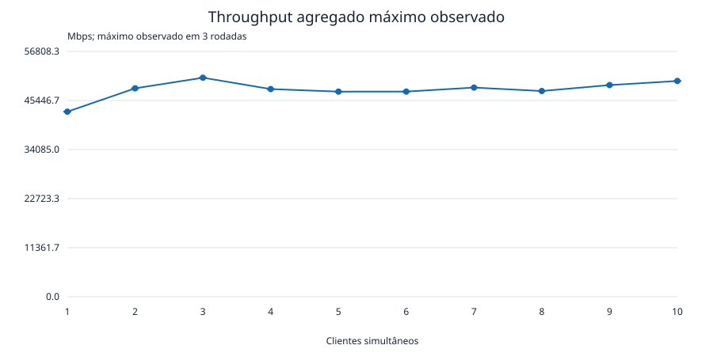
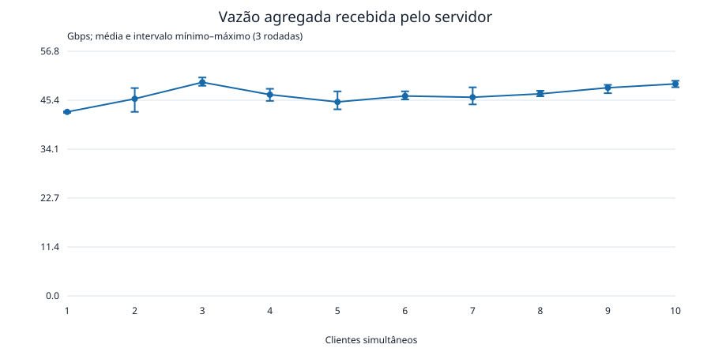

# Relatório técnico — throughput agregado de um servidor TCP

Davi de Oliveira Custódio - 176468  
Nicolas David - 176612  
Luis Felipe Salgado Mitidieri - 158555

## 1. Objetivo

Avaliar o impacto de 1 a 10 clientes transmitindo simultaneamente para um servidor TCP multithread. Para cada quantidade de clientes, determina-se o throughput agregado máximo observado entre três repetições, em Mbps, acompanhado da média e da dispersão.

## 2. Características da máquina e configuração da rede

Cliente e servidor foram executados na **mesma máquina física**. Cada cliente é um processo independente; o servidor utiliza uma thread receptora por conexão.

| Componente | Configuração utilizada |
|---|---|
| Processador | Intel Core i5-1135G7 @ 2,40 GHz, arquitetura x86_64, 4 núcleos físicos e 8 threads lógicas |
| Memória RAM | 15 GiB utilizáveis reportados pelo sistema; swap de 2 GiB |
| Sistema operacional | Linux Mint 22.3, kernel Linux 6.8.0-149-generic |
| Compilador | GCC 13.3.0 (`cc`) |
| Compilação | `-O2 -Wall -Wextra -std=gnu11`, ligação com `-pthread` |
| Rede | TCP sobre IPv4, interface de loopback, destino `127.0.0.1`, porta 5000 |
| Máquinas utilizadas | Um único computador compartilhado pelos processos clientes e pelo servidor |
| Opções TCP | `TCP_NODELAY=0`; `SO_SNDBUF` e `SO_RCVBUF` sem ajuste explícito (`0` nos argumentos) |

O tráfego não atravessa uma placa de rede ou um enlace externo. Portanto, não se atribui a esse ensaio uma velocidade de Ethernet ou Wi-Fi. A configuração caracteriza o processamento local da pilha TCP, a movimentação de dados e a concorrência no host. Os metadados foram registrados em 2026-11-10T21:33:18.455419-03:00 e estão em [ambiente.json](resultados/ambiente.json).

## 3. Metodologia experimental e comparabilidade

| Parâmetro | Valor |
|---|---|
| Clientes simultâneos | 1, 2, 3, 4, 5, 6, 7, 8, 9 e 10 |
| Repetições | 3 para cada quantidade; 30 rodadas ao todo |
| Duração de envio | 10 segundos por cliente em cada rodada |
| Janela efetivamente medida | 10.000 a 10.009 s |
| Bloco solicitado em cada `send()` | 131072 bytes (128 KiB) |
| Buffer de cada thread receptora | 262144 bytes (256 KiB) |
| Ordem | N crescente de 1 a 10, com 3 repetições consecutivas por N |
| Conteúdo | Bytes de preenchimento, recebidos e descartados; sem broadcast e sem digitação |

O script inicia um novo servidor por rodada e espera a mensagem de escuta no log. Isso evita abrir uma conexão de sondagem que seria contada como cliente. Em seguida, inicia N processos clientes. O servidor aceita todos, consome a identificação inicial, cria as threads receptoras, registra o início e envia `GO` a cada cliente. Os clientes aguardam esse sinal e transmitem até seu prazo local de 10 segundos; depois encerram o sentido de escrita da conexão.

A comparabilidade foi favorecida pelo uso dos mesmos executáveis, máquina, interface, protocolo, duração, tamanho de bloco e opções de socket em todas as rodadas. A barreira de início evita que um cliente comece enquanto os demais ainda estão sendo conectados. O envio de `GO` ocorre sequencialmente e não garante início exatamente no mesmo nanossegundo; a janela agregada inclui essa diferença.

Não houve aquecimento separado, aleatorização da ordem, fixação da afinidade de CPU, controle térmico ou isolamento de carga externa. Um teste curto de integração foi executado durante a campanha, sendo uma possível interferência pontual. Esses fatores limitam a comparabilidade ideal e podem contribuir para a variação. Três repetições fornecem uma descrição inicial da variabilidade.

## 4. Cálculo da taxa de transmissão agregada

Cada thread mantém seu próprio contador de bytes e o incrementa apenas quando `recv()` retorna um número positivo. Assim, são contados os bytes de payload efetivamente recebidos, sem incluir o nome do handshake, o sinal `GO` ou cabeçalhos TCP/IP. O tamanho de bloco é uma solicitação de envio: o TCP pode produzir envios e recebimentos parciais.

Após todas as threads terminarem, o servidor executa `pthread_join()` e agrega seus contadores. Se B_i representa os bytes recebidos pela thread i, então:

```text
B_total = soma(B_i), para i = 1, ..., N
T_ns    = max(instante_EOF_i) − instante_inicial
Taxa agregada (Mbps) = B_total × 8000 / T_ns
                    = B_total × 8 / (T_segundos × 1.000.000)
```

O início é obtido por `clock_gettime(CLOCK_MONOTONIC)` antes do envio do sinal de início. Cada thread registra o fim ao concluir o recebimento, normalmente no EOF. Usar o maior instante final inclui a drenagem da última conexão. A janela pode, por isso, exceder os 10 segundos de envio. Não se somam taxas individuais calculadas com denominadores diferentes.

Por exemplo, na segunda rodada com um cliente, foram recebidos 53.575.155.712 bytes, com janela exportada de 10,000 s e taxa de 42.859,16 Mbps. A taxa é calculada com nanossegundos antes da formatação: o CSV arredonda segundos a três casas e Mbps a duas. Recalcular a taxa usando apenas os segundos arredondados pode produzir uma diferença pequena.

Define-se **throughput agregado máximo observado para N clientes** como o maior valor agregado entre as três rodadas com esse N. Não é um pico instantâneo nem uma estimativa do limite teórico do equipamento. A média é aritmética, o desvio padrão é amostral (divisor R−1) e o coeficiente de variação é `100 × desvio/média`.

## 5. Resultados: clientes versus throughput agregado máximo

Todos os valores de throughput nesta tabela estão em **Mbps**. O máximo é a métrica principal solicitada; as demais colunas permitem avaliar sua representatividade.

| Clientes simultâneos | Máximo (Mbps) | Média (Mbps) | Desvio padrão (Mbps) | Mínimo (Mbps) | CV (%) |
|---|---|---|---|---|---|
| 1 | 42859.16 | 42737.16 | 186.62 | 42522.32 | 0.44 |
| 2 | 48264.03 | 45780.60 | 2799.42 | 42746.91 | 6.11 |
| 3 | 50721.73 | 49608.55 | 996.86 | 48798.29 | 2.01 |
| 4 | 48097.36 | 46744.39 | 1407.46 | 45288.14 | 3.01 |
| 5 | 47504.19 | 45049.23 | 2181.14 | 43334.67 | 4.84 |
| 6 | 47510.50 | 46426.22 | 973.54 | 45627.13 | 2.10 |
| 7 | 48437.83 | 46138.41 | 2056.49 | 44475.24 | 4.46 |
| 8 | 47642.52 | 46929.23 | 647.91 | 46377.13 | 1.38 |
| 9 | 49014.22 | 48346.27 | 1101.57 | 47074.83 | 2.28 |
| 10 | 49963.96 | 49234.67 | 748.34 | 48468.64 | 1.52 |



**Figura 1.** Maior throughput agregado observado nas três rodadas para cada quantidade de clientes, em Mbps.



**Figura 2.** Média agregada e intervalo mínimo–máximo das três rodadas, em Gbps, para facilitar a leitura da dispersão. As barras não são intervalos de confiança.

### 5.1. Taxas por repetição

| Clientes | Rodada 1 (Mbps) | Rodada 2 (Mbps) | Rodada 3 (Mbps) |
|---|---|---|---|
| 1 | 42829.99 | 42859.16 | 42522.32 |
| 2 | 42746.91 | 46330.86 | 48264.03 |
| 3 | 48798.29 | 50721.73 | 49305.64 |
| 4 | 46847.68 | 48097.36 | 45288.14 |
| 5 | 47504.19 | 44308.83 | 43334.67 |
| 6 | 46141.02 | 47510.50 | 45627.13 |
| 7 | 48437.83 | 45502.16 | 44475.24 |
| 8 | 46377.13 | 47642.52 | 46768.03 |
| 9 | 49014.22 | 48949.75 | 47074.83 |
| 10 | 48468.64 | 49963.96 | 49271.41 |

Os totais de bytes e as janelas correspondentes a cada rodada estão disponíveis no [CSV de medições brutas](resultados/resultados.csv). O [resumo estatístico](resultados/resumo.csv) contém os indicadores calculados.

## 6. Discussão do aumento do número de clientes

O maior throughput de toda a campanha foi **50721.73 Mbps**, com **3 clientes**, na segunda rodada. O máximo com um cliente foi 42859.16 Mbps; com dez, 49963.96 Mbps. A variação entre esses dois máximos é de 16.58%, correspondendo a 1.17 vezes a taxa inicial, apesar do aumento de dez vezes no número de conexões.

A média aumentou de 42737.16 Mbps com um cliente para 49234.67 Mbps com dez, um aumento de 15.20%. A maior média também ocorreu com três clientes: 49608.55 Mbps. Entre quatro e dez clientes há oscilações, sem crescimento monotônico. Isso é compatível com um regime de capacidade compartilhada, no qual mais conexões não resultam em acréscimo proporcional de vazão.

O CV variou de 0.44% a 6.11%. Como o máximo seleciona a melhor das três rodadas, ele pode refletir condições pontualmente favoráveis; a média e a dispersão devem acompanhá-lo. A diferença entre três e dez clientes não permite afirmar que três seja universalmente a configuração ótima, dada a pequena amostra e a ausência de controle de carga e frequência.

Dividir a média agregada por N resulta em 42737.16 Mbps por cliente para N=1 e 4923.47 Mbps para N=10. Essa é uma razão derivada; não demonstra distribuição uniforme entre conexões, pois não foram preservadas medições individuais por cliente.

## 7. Limites observados e possíveis gargalos

O maior valor observado foi aproximadamente 50.72 Gbps em loopback. Não houve evidência de escalabilidade linear de 1 a 10 clientes. Esse é um limite empírico desta campanha, não uma capacidade máxima garantida do servidor.

Os possíveis gargalos são:

- **Processamento da pilha TCP e chamadas de sistema:** os clientes executam `send()` continuamente e as threads do servidor executam `recv()`, consumindo CPU mesmo sem tratamento de aplicação.
- **Cópias de memória e hierarquia de cache:** clientes, kernel e servidor movimentam grandes volumes de dados na mesma máquina, compartilhando memória e caches.
- **Escalonamento e concorrência:** para N=10 existem dez processos emissores e dez threads receptoras ativas em uma CPU com oito processadores lógicos, além das tarefas do sistema. A concorrência pode elevar trocas de contexto e disputa por recursos.
- **Buffers e controle de fluxo TCP:** os valores efetivos dependem dos padrões do kernel. O ensaio não variou esses parâmetros nem registrou seus valores efetivos por conexão.
- **Frequência, temperatura e carga externa:** não foram controladas e podem explicar parte das oscilações entre rodadas.

Esses mecanismos são hipóteses plausíveis. Não foram coletados perfis de CPU, utilização por núcleo, trocas de contexto, largura de banda de memória ou retransmissões para determinar causalmente o gargalo. Como não existe enlace físico no trajeto, estes resultados não demonstram saturação de uma placa de rede. O benchmark também não mede broadcast do chat, latência ou ganho em relação ao código original.

## 8. Verificação dos testes frente aos requisitos

Os dados existentes correspondem ao experimento pedido: N=1…10, três repetições de 10 segundos e transmissão automática sincronizada pelo servidor. A validação do CSV confirmou exatamente 30 registros, rodadas 1/2/3 para cada N, bytes positivos, janela de pelo menos 10 s e compatibilidade entre bytes, tempo e taxa dentro dos arredondamentos de exportação. O máximo de cada grupo foi recalculado diretamente dessas taxas.

| Verificação | Evidência e resultado |
|---|---|
| Cálculo de Mbps (CA1) | Testes unitários: 1.250.000.000 bytes em 10 s → 1000 Mbps; tempo zero rejeitado; passaram |
| Agregação (CA2) | Soma de contadores, maior EOF menos início, N=0 e EOF anterior ao início; passaram |
| Formato de saída (CA3) | CSV exato e rejeição de buffer insuficiente; passaram |
| Argumentos (CA4/CA5) | Seleção dos modos, padrões, limites e entradas inválidas; passaram |
| Sincronização e recepção (CA6) | Integração com dois sockets: nenhum GO antes do segundo cliente, GO para ambos, payloads somando exatamente 80.235 bytes, CSV único e término com código 0; passou e foi repetida nesta revisão |
| Campanha N=1…10 | 30 medições reais completas, registradas em CSV e log; consistência numérica validada nesta revisão |
| Requisito de máximo por N | Tabela e Figura 1 apresentam o máximo agregado em Mbps para todos os N de 1 a 10 |

`make test` foi repetido nesta revisão e passou. Na campanha original, o núcleo passou também com AddressSanitizer e UndefinedBehaviorSanitizer, com `ASAN_OPTIONS=detect_leaks=0`; a execução de LeakSanitizer foi bloqueada pelo ambiente com ptrace, portanto não houve validação de vazamentos. A compilação emitiu um aviso preexistente de possível truncamento do nome em `server_chat.c:119`, fora do caminho de benchmark.

A especificação fornecida não exige máquinas distintas. O ensaio em loopback atende à variação de clientes e à medição agregada, mas a interpretação fica restrita ao host. Para avaliar uma rede física, é necessário repetir a campanha em computadores separados e documentar ambos os equipamentos, interfaces, velocidade do enlace e topologia.

## 9. Códigos-fonte, compilação e execução

Cliente e servidor modificados compartilham o repositório GitHub configurado como `origin` neste projeto:

- [Repositório do cliente e do servidor — Sockets_Atividade](https://github.com/Nicolas-David-Unifesp/Sockets_Atividade).
- [Cliente: main e modo chat](https://github.com/Nicolas-David-Unifesp/Sockets_Atividade/blob/56ac0c942319c697d15d006dd3bdf83c91440e1d/client_chat.c) e [implementação de benchmark](https://github.com/Nicolas-David-Unifesp/Sockets_Atividade/blob/56ac0c942319c697d15d006dd3bdf83c91440e1d/bench_client.c).
- [Servidor: main e modo chat](https://github.com/Nicolas-David-Unifesp/Sockets_Atividade/blob/56ac0c942319c697d15d006dd3bdf83c91440e1d/server_chat.c) e [implementação de benchmark](https://github.com/Nicolas-David-Unifesp/Sockets_Atividade/blob/56ac0c942319c697d15d006dd3bdf83c91440e1d/bench_server.c).
- [Núcleo de cálculo e validação](https://github.com/Nicolas-David-Unifesp/Sockets_Atividade/blob/56ac0c942319c697d15d006dd3bdf83c91440e1d/bench_core.c).

A versão local utilizada na campanha é o commit `56ac0c942319c697d15d006dd3bdf83c91440e1d`. Os endereços foram obtidos da configuração Git local; a disponibilidade pública desse commit não pôde ser confirmada nesta revisão. Os novos testes, gráficos e este relatório são arquivos locais desta entrega; sua publicação no GitHub não foi realizada.

### 9.1. Requisitos e compilação

É necessário um ambiente Linux com compilador C compatível com GNU11, Make e POSIX threads. Bash é usado na campanha e Python 3 no teste de integração e na geração deste relatório.

```sh
git clone https://github.com/Nicolas-David-Unifesp/Sockets_Atividade.git
cd Sockets_Atividade
git checkout 56ac0c942319c697d15d006dd3bdf83c91440e1d
make
```

O comando gera `./server` e `./client`.

### 9.2. Execução manual de uma rodada

Exemplo com quatro clientes, em dois terminais da mesma máquina:

```sh
# Terminal 1: servidor esperando quatro clientes
./server 5000 --bench 4 0
```

```sh
# Terminal 2: quatro clientes simultâneos, por 10 s
for i in 1 2 3 4; do
    ./client 127.0.0.1 5000 --bench 10 131072 0 0 &
done
wait
```

O servidor imprime `clientes,bytes,segundos,mbps`. Uma nova rodada exige reiniciar o servidor. Para máquinas distintas, substitua `127.0.0.1` pelo IPv4 da máquina servidora, permita TCP na porta utilizada e execute os processos clientes na outra máquina.

### 9.3. Campanha automatizada e verificações locais

```sh
mkdir -p resultados
bash run_bench.sh -d 10 -n 10 -r 3 -b 131072 -t 0 -s 0 -R 0 -p 5000 -o resultados/resultados.csv
```

A campanha sobrescreve o CSV de destino. Para a cópia local que inclui os testes e scripts desta entrega:

```sh
make test
make test-integration
make report
```

Os testes de integração e a campanha precisam de permissão para abrir sockets TCP locais. A geração dos gráficos e do Markdown usa a biblioteca padrão do Python, sem dependências externas. O arquivo de ambiente corresponde à campanha original e deve ser atualizado para uma nova campanha.

## 10. Conclusão

O experimento mediu o throughput agregado para todas as quantidades de 1 a 10 clientes. O maior máximo foi 50721.73 Mbps com três clientes, enquanto dez clientes alcançaram 49963.96 Mbps. O aumento de concorrência trouxe ganho limitado frente a um cliente e não produziu crescimento proporcional. Os resultados apontam uma faixa de capacidade compartilhada da execução local; a identificação do gargalo exige instrumentação adicional e a avaliação de rede física exige repetir o ensaio fora do loopback.

## Repositório

[https://github.com/Nicolas-David-Unifesp/Sockets_Atividade](https://github.com/Nicolas-David-Unifesp/Sockets_Atividade)
